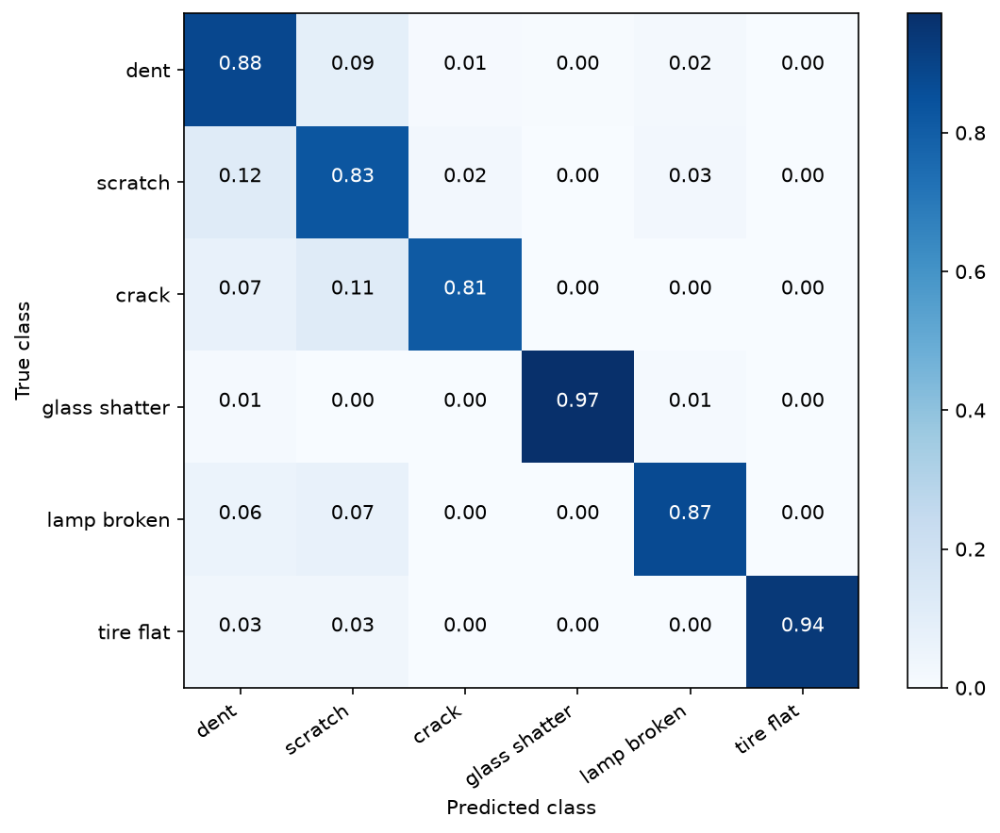
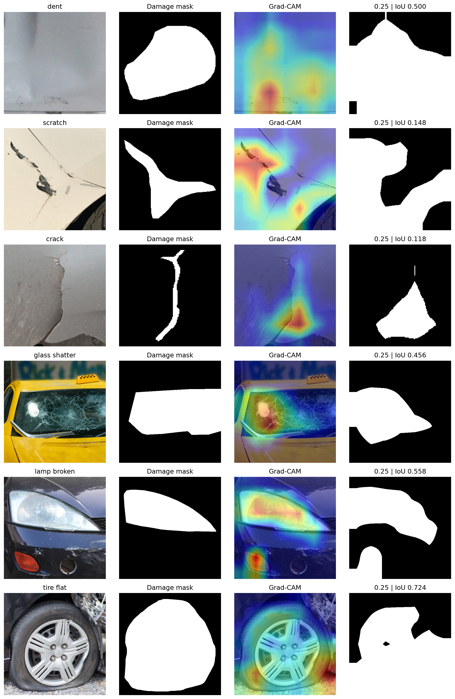
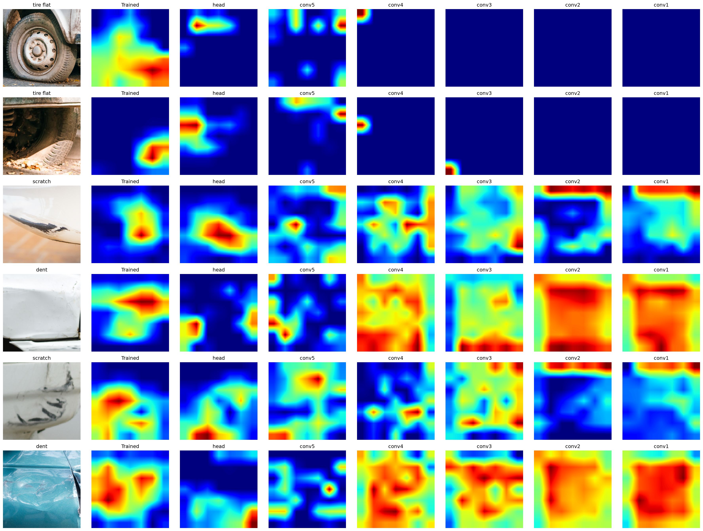

# Explainable Vehicle Damage Classification

**An evaluation of Grad-CAM using the CarDD dataset**

Train a vehicle damage classifier, visualize its predictions, and evaluate how closely its explanations match annotated damage.

[Workflow](#workflow) · [Dataset](#dataset) · [Results](#results) · [Grad-CAM localization](#grad-cam-localization) · [Sanity check](#parameter-randomization-sanity-check)

---

## Workflow

| Step | Notebook | Purpose |
| :---: | :--- | :--- |
| **01** | [Data preparation](notebooks/data_prep.ipynb) | Validate annotations and prepare damage-crop manifests. |
| **02** | [Training](notebooks/training.ipynb) | Train ResNet50 and select the Grad-CAM threshold on validation data. |
| **03** | [Evaluation](notebooks/evaluation.ipynb) | Evaluate classification, explanation localization, and parameter sensitivity on the test set. |

### 01 · Data preparation

The notebook loads images and **COCO-format annotations** from the existing training, validation, and test splits. It checks image readability, image dimensions, duplicate identifiers, category references, bounding boxes, and segmentation masks.

Each damage annotation becomes a **separate classification sample**. The code constructs a **square crop with 5% padding per side**, measured relative to the longer bounding-box dimension. The crop origin is adjusted to keep the square inside the image where possible. External padding preserves the square dimensions when the requested crop cannot fit within the image. The corresponding damage mask uses identical crop coordinates.

It saves a **sample manifest**, **class-index mapping**, and **crop configuration**. Image crops are extracted from the original files later using the manifest. All samples from the same source image remain in the same dataset split.

### 02 · Training

The notebook reads the prepared manifest and trains an **ImageNet-pretrained ResNet50** classifier. Square crops are resized to **224 × 224** and processed with ResNet50's input preprocessing. Training images receive horizontal flips, rotations within approximately **±10.8°**, and contrast augmentation. **Class weights** calculated from training samples address the unequal class distribution.

The classification head consists of global average pooling, **0.3 dropout**, and a dense layer producing six class logits. Both training stages use Adam, sparse categorical cross-entropy computed from logits, and a batch size of **32**.

Training takes place in two stages:

1. **Classification head · 15 epochs:** train the head with the backbone frozen, using an initial learning rate of **0.001**.
2. **Fine-tuning · 20 epochs:** fine-tune ResNet50's final convolutional stage while keeping earlier stages and all batch-normalization layers frozen, using an initial learning rate of **0.00001**.

The final checkpoint is selected by the **lowest validation loss** across both stages. The selected checkpoint occurred at **fine-tuning epoch 6**, with a validation loss of **0.4941** and validation accuracy of **84.12%**. Later fine-tuning showed increasing validation loss despite improving training performance.

Grad-CAM heatmaps explain the **ground-truth class** and are compared with the selected annotation's mask using **intersection over union (IoU)** and the **pointing game**. The notebook selects a heatmap threshold from **19 candidates (0.05–0.95)** using validation IoU. A small, class-balanced parameter-randomization check examines whether explanations depend on learned model weights.

### 03 · Evaluation

The notebook loads the saved model, training configuration, and **validation-selected threshold**. It verifies dataset file hashes and evaluates classification and Grad-CAM localization on **every test crop**. It also generates explanation galleries and repeats the parameter-randomization check across the full test set. Reports, predictions, heatmaps, and evaluation settings are saved for subsequent analysis.

Classification is assessed using accuracy, per-class precision, recall, and F1-score, macro and weighted averages, and a confusion matrix.

Quantitative localization uses **ground-truth-class heatmaps**, including for misclassified samples. Additional **predicted-class heatmaps** support qualitative analysis of selected errors. Ground-truth-class heatmaps show evidence for the annotated category; predicted-class heatmaps show evidence for the category assigned by the model.

> **Evaluation scope:** Localization results assess explanations within annotated crops; they do not measure full-image damage detection. Spatial overlap and parameter sensitivity do not establish that highlighted regions caused a prediction.

## Dataset

| Split | Source images | Damage samples |
| :--- | ---: | ---: |
| Training | 2,816 | 6,211 |
| Validation | 810 | 1,744 |
| Test | 374 | 785 |
| **Total** | **4,000** | **8,740** |

The six damage categories are **dent, scratch, crack, glass shatter, lamp broken, and tire flat**. Scratch and dent together account for approximately **70%** of the prepared samples.

---

## Results

### Classification performance

| Test metric | Score |
| :--- | ---: |
| **Accuracy** | **86.50%** |
| Macro precision | 89.21% |
| Macro recall | 88.42% |
| **Macro F1** | **88.74%** |
| Weighted precision | 86.70% |
| Weighted recall | 86.50% |
| Weighted F1 | 86.52% |

The model correctly classified **679 of 785 test crops**.

Performance was strongest for **glass shatter** and **tire flat**, with F1-scores of **97.18%** and **96.77%**, respectively. **Crack** achieved the lowest F1-score of **83.82%**.

The confusion matrix showed that **dent** and **scratch** were most frequently confused: **36 scratch samples were predicted as dent**, while **21 dent samples were predicted as scratch**.

  
   
  <em>Figure 1 · Test-set confusion matrix.</em>

### Grad-CAM localization

| Localization metric | Value |
| :--- | ---: |
| Validation-selected threshold | 0.25 |
| Mean validation IoU at selected threshold | 0.3781 |
| **Mean test IoU** | **0.3865** |
| Macro-average test IoU | 0.4307 |
| **Pointing-game accuracy** | **67.13%** |
| Pointing-game hits | 527 |
| Test crops | 785 |

These results indicate **partial, category-dependent alignment** between the highlighted regions and annotated damage. The strongest heatmap point fell within the damage mask in **527 of 785 crops**, approximately **two out of three samples**.

**Tire flat** achieved the highest mean IoU of **0.6045**, while **glass shatter** achieved the highest pointing-game accuracy of **94.37%**. **Crack** had the lowest mean IoU of **0.1828** and pointing-game accuracy of **34.29%**.

Correctly classified samples had higher mean IoU than misclassified samples in all six categories. However, classification correctness and localization quality remain distinct: a misclassified sample can still produce a ground-truth-class heatmap that highlights the annotated damage.

Grad-CAM uses **7 × 7 feature maps**, limiting its spatial detail. Upsampling these maps does not recover precise damage boundaries, particularly for thin or irregular damage such as cracks and scratches.

  
   
  <em>Figure 2 · Grad-CAM explanation gallery on the test set.</em>

### Parameter-randomization sanity check

The sanity check cumulatively randomized the **classification head**, followed by **conv5, conv4, conv3, conv2, and conv1**, while keeping the input crops and ground-truth target classes fixed. The randomized model was not retrained.

Mean Spearman correlation was **0.1776** after head randomization. After convolutional-stage randomization, mean correlations remained close to zero, ranging from **−0.0452 to 0.0555**, indicating little average agreement with the trained model's spatial importance rankings.

Mean absolute heatmap differences generally increased as randomization progressed toward the input, rising from **0.2371** after head randomization to **0.3274** at conv2, before decreasing to **0.3012** at conv1. The changes were therefore not strictly monotonic.

These findings support that the Grad-CAM explanations **depend on learned model parameters**. Constant heatmaps were excluded from Spearman averages because their correlations are undefined, reducing valid comparisons from **779** after head randomization to **682** at the final stage. Constant maps remained included in MAE calculations.

Each heatmap was independently normalized, so MAE measures differences in **relative activation patterns**, rather than absolute class-score magnitude. The check used a **single random seed** and did not include training-label randomization.

> **Interpretation:** The sanity check supports parameter sensitivity. Localization accuracy is assessed separately through IoU and the pointing game.

  
   
  <em>Figure 3 · Heatmap changes during parameter randomization.</em>

